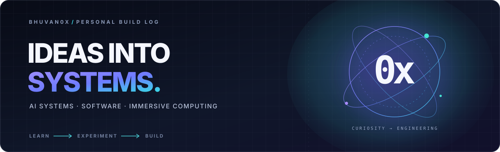
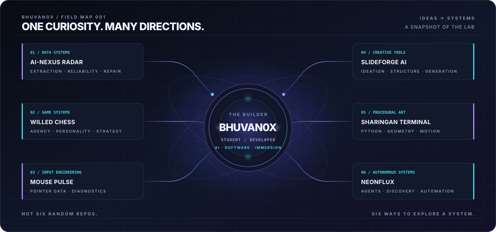

 

 

<table>
<tr>
<td width="62%" valign="top">

### 01 / THE OPERATOR

I'm **Bhuvan** — a student developer exploring the edge between software, intelligence, and human experience.

My curiosity lives in **AI systems, local-first computing, and immersive technology**. I like taking a big idea, opening it up, and figuring out how the pieces could actually work.

</td>
<td width="38%" valign="top">

### CURRENT COORDINATES

**FOCUS**  
AI · VR / AR · HCI

**MODE**  
Learn → Experiment → Build

**LONG GAME**  
Next-generation immersive systems

**NORTH STAR**  
Science & Engineering in Japan

</td>
</tr>
</table>

## 02 / SELECTED BUILDS

Not a list of tutorials. A few experiments, tools, and systems I've put together.

<table>
<tr>
<td width="50%" valign="top">

**[01 — AI-NEXUS RADAR ↗](https://github.com/bhuvan0x/ai-nexus-radar)**

A reliability-first web extraction workspace. Detects missing data and schema drift, then routes collectors through a human-reviewed repair loop.

AI · DATA SYSTEMS · RELIABILITY

</td>
<td width="50%" valign="top">

**[02 — WILLED CHESS ↗](https://github.com/bhuvan0x/Willed-Chess)**

Chess with a twist: pieces have behavioral tendencies, morale, loyalty, and personalities. Strategy meets a piece-level command system.

GAME SYSTEMS · INTERACTION · WEB

</td>
</tr>
<tr>
<td width="50%" valign="top">

**[03 — MOUSE PULSE ↗](https://github.com/bhuvan0x/Mouse-Pulse)**

A browser-based mouse diagnostics lab for click, movement, scroll, polling-rate estimates, and CPI/DPI calibration.

REACT · TYPESCRIPT · BROWSER APIS

</td>
<td width="50%" valign="top">

**[04 — SLIDEFORGE AI ↗](https://github.com/bhuvan0x/SlideForge-AI)**

Turns a rough presentation idea into a structured slide-by-slide content plan — from blank page to a clear direction.

GENERATIVE AI · PRODUCTIVITY · WEB

</td>
</tr>
<tr>
<td width="50%" valign="top">

**[05 — SHARINGAN TERMINAL ↗](https://github.com/bhuvan0x/Sharingan-Animation-in-Terminal)**

Procedural anime-inspired eye animations drawn live in the terminal with Python and ANSI true-colour graphics.

PYTHON · GENERATIVE GRAPHICS · TERMINAL

</td>
<td width="50%" valign="top">

**[06 — NEONFLUX ↗](https://github.com/bhuvan0x/NeonFlux---Autonomous-AI-Creator-System)**

An autonomous content-generation experiment: discover relevant Hacker News topics, evaluate them against a persona, and draft posts.

AI AGENTS · AUTOMATION · NODE.JS

</td>
</tr>
</table>

[ **EXPLORE ALL REPOSITORIES →** ](https://github.com/bhuvan0x?tab=repositories)

---

## 03 / CURRENT EXPERIMENT — ALYA PRIMEBOOK

<table>
<tr>
<td width="56%" valign="top">

### A voice assistant. Running locally.

I'm building a personal assistant pipeline on modest hardware, with the goal of keeping inference and voice processing on-device.

The interesting part isn't a chatbot window. It's making the whole loop work:

**hear → understand → reason → speak**

</td>
<td width="44%" valign="top">

~~~text
MICROPHONE
    ↓
WHISPER / ASR
    ↓
LOCAL QWEN MODEL
    ↓
DIALOGUE LAYER
    ↓
QWEN3-TTS
    ↓
SPEAKER
~~~

</td>
</tr>
</table>

The project is an ongoing systems experiment in local inference, speech interfaces, latency, and constrained-device engineering.

---

## 04 / TOOLBOX

  

**AI / AUDIO EXPERIMENTS**

llama.cpp · Whisper · Qwen3-TTS · Local LLMs

**EXPLORING**

AR / VR · Human–Computer Interaction · Machine Learning

Tools I've used or am actively exploring — not a claim of expertise in every item.

---

## 05 / ACTIVITY LOG

 

Six projects. Different disciplines. One habit: take things apart, understand them, build something better.

---

### LESS TALK. MORE ITERATION.

I'm here to learn difficult things, build real projects, and keep raising the bar.

<a href="https://github.com/bhuvan0x?tab=repositories">REPOSITORIES</a>
&nbsp; ◈ &nbsp;
<a href="https://www.linkedin.com/in/bhuvan0x/">LINKEDIN</a>

  

BHUVAN0X // END OF TRANSMISSION

